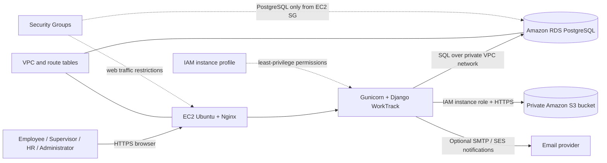
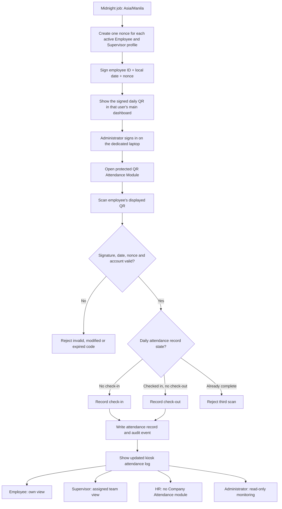
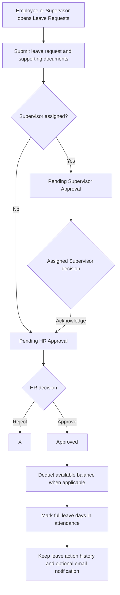
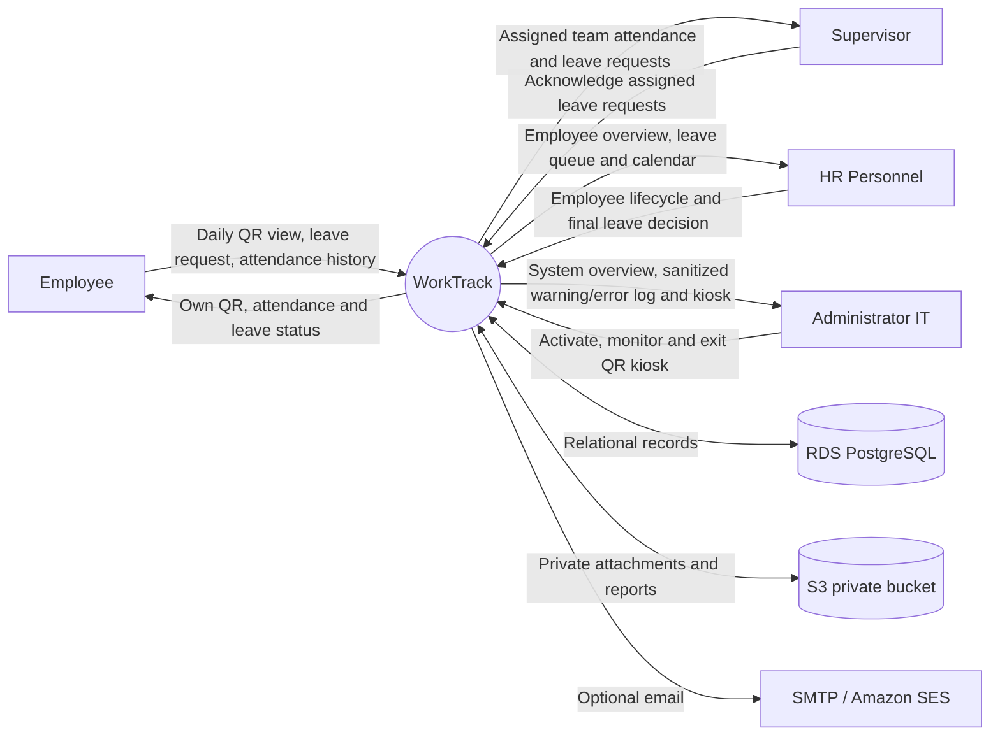
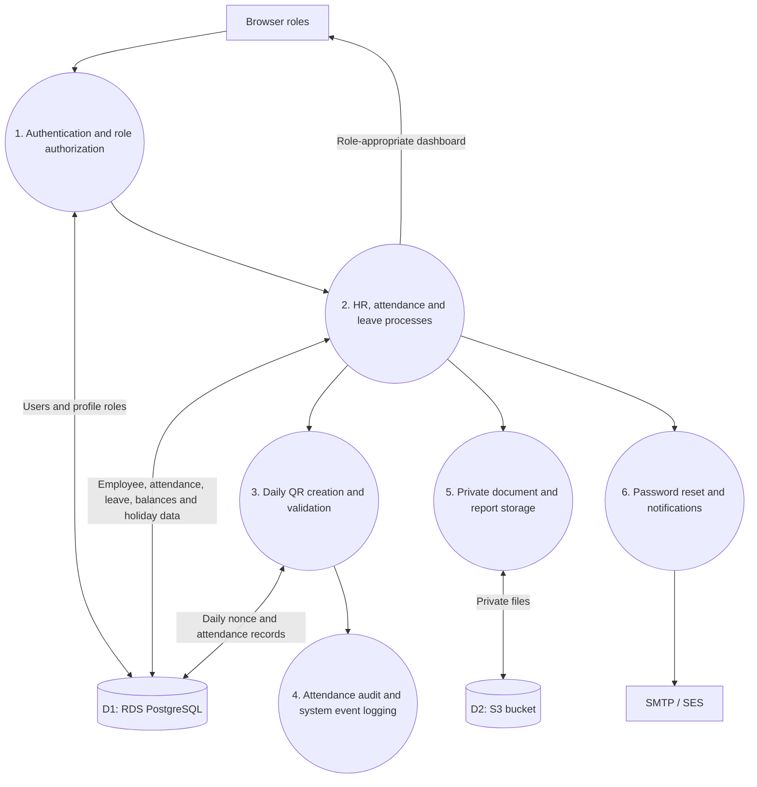
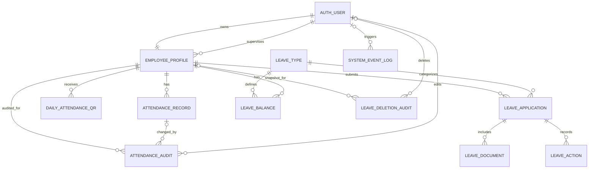

# WorkTrack System Architecture (aligned with SYSARCH.drawio)

## 1. Organizational structure and roles

The supplied system architecture defines four WorkTrack roles and a clear division between People Operations and IT support.

| Role | Main responsibility | Application permissions |
|---|---|---|
| Employee | Personal attendance and leave requests | View own dashboard and daily QR, view own attendance, submit/cancel pending leave requests, view leave balances and request history |
| Supervisor | Team monitoring and first-stage leave review | View own QR and attendance, view assigned team attendance, inspect team leave requests, acknowledge requests submitted by assigned direct reports, submit own leave through Leave Requests; cannot approve or reject |
| HR Personnel | Employee lifecycle and leave administration | Create/update employee and supervisor accounts, update employment status, conduct final leave review after Supervisor acknowledgement, manage leave balances and holidays, view standard leave catalogue, view HR overview |
| Administrator (IT Personnel) | Application oversight, access/error handling and attendance kiosk operations | View system overview and error logs, view attendance logs, operate the protected QR kiosk; attendance and leave records are read-only, change own password and use password recovery. Cannot hire/manage employee profiles or process leave decisions. |

Department and job-position values are company classifications, while Employee, Supervisor, HR Personnel, and Administrator remain the only WorkTrack security roles. The initial HR account is provisioned under the HR department with the HR Manager job title. The six department descriptions shown on the account form are guidance from the company's reference table; they do not independently grant report or approval permissions.

The Administrator role is deliberately separated from HR operations. The application's `/admin/` Django administration console is not exposed as a second general-purpose business-data interface. The initial IT Administrator account is provisioned using Django `createsuperuser`; initial HR Personnel is provisioned with the `create_hr_user` management command. HR subsequently creates Employee and Supervisor accounts through WorkTrack.

## 2. Main dashboard and module layout

### Employee dashboard

- Main dashboard includes the employee's daily QR code, attendance status, attendance history summary, leave status and leave balances.
- Attendance opens the employee's own per-day records.
- Leave Requests contains the new leave application action and the list of existing requests. There is no separate Leave Application item in the sidebar.

### Supervisor dashboard

- Main dashboard includes the supervisor's own daily QR code and team attendance/leave summaries.
- Team Attendance is limited to employees assigned as primary or backup reports, plus the supervisor's own records.
- Team Leave Requests contains both the request list and the action to submit the supervisor's own leave request.
- Team Leave Approvals shows only pending first-stage requests assigned to that supervisor.

### HR dashboard

- Main dashboard includes employee count, leave approval summary, and HR workflow overview. HR is a role account and does not receive an employee QR code.
- Employees Overview is limited to Employee and Supervisor profiles. HR can create, update, and change the employment status of these profiles.
- The Company Attendance module is not available to HR. HR performs employee lifecycle management and final leave decisions after the assigned Supervisor acknowledges the request.
- Leave Requests and HR Approval Queue provide the final decision stage.
- Standard Leave Types is a read-only view of the same company-wide catalogue used by all employees.
- HR maintains leave balances and the Holiday Calendar.

### Administrator dashboard

- System Overview contains operational counters and recent warning/error events. The log display suppresses actor and employee identity.
- System Logs / Errors shows sanitized login, access-denied, rate-limit and HTTP error events.
- Attendance Logs is a read-only per-employee view. The Administrator cannot edit attendance records.
- QR Attendance Module is the secured laptop kiosk. It displays the latest daily attendance entries in the same module as the scanner.
- The administrator can change their own password. Forgot-password recovery is available from the login page.

## 3. AWS application architecture

The user's browser reaches the EC2 web server through HTTPS. Nginx forwards requests to Gunicorn and Django. Django stores relational business data in RDS PostgreSQL and private leave attachments/reports in S3. The EC2 instance role authorizes S3 and Secrets Manager operations without embedding long-lived AWS keys in source code.

The included CloudFormation baseline creates one public subnet for EC2 and two private subnets across separate Availability Zones for the RDS subnet group. RDS has no public address and its security group accepts database traffic only from the EC2 security group. An S3 gateway endpoint provides private VPC routing to S3.

## 4. QR attendance workflow

`generate_daily_attendance_qr` creates one daily QR record for each active Employee and Supervisor profile. HR and Administrator are role accounts and do not receive employee QR credentials. The signed payload contains the employee profile ID, the current local date, a random nonce and a version. The code is valid only for the date encoded in the payload and is rejected after the Asia/Manila midnight boundary. Dashboard rendering creates the row as a fallback if the scheduled task has not run yet.

The kiosk page and its scan endpoint independently require an authenticated Administrator. Production may additionally restrict both to the dedicated kiosk network using `WORKTRACK_KIOSK_IP_RANGES`. Browser camera access requires localhost during development or HTTPS in production. An employee-specific daily QR is a bearer credential, not biometric identification; the kiosk operator should verify the person presenting the code.

## 5. Leave request workflow

Only the assigned primary/backup Supervisor can acknowledge and forward the request. Supervisors cannot approve or reject. Only HR can perform final approval or HR-stage rejection after acknowledgement is recorded. Administrator can inspect leave metadata read-only but cannot approve, reject, delete or download supporting documents. Employees and supervisors access the Leave Application through the Leave Requests module rather than a separate sidebar module.

## 6. Standardized leave categories

All employees use one shared company-wide fixed leave catalogue. The application UI does not allow individual departments or users to create different categories. Migration `0031_system_event_log_and_fixed_leave_catalogue` installs these initial values:

| Code | Standard category | Paid flag | Balance tracking |
|---|---|---:|---:|
| VL | Vacation Leave | Yes | Yes |
| SL | Sick Leave | Yes | Yes |
| EL | Emergency Leave | Yes | No |
| PL | Personal Leave | Yes | No |
| LWOP | Leave Without Pay | No | No |

The flags are initial WorkTrack configuration values, not a statement of a statutory entitlement or a substitute for the employer's leave policy. To change the standard catalogue, developers should revise the data migration and apply a reviewed migration. HR can view the catalogue but cannot add, rename, deactivate or delete types from the web application.

## 7. System event and audit handling

`SystemEventLoggingMiddleware` records selected HTTP error responses (400, 403, 404, 429 and 5xx) in `eqrApp_systemeventlog`. The login view also records successful and failed sign-in attempts. Stored event fields include event type, severity, message, request path, method, response status, optional authenticated actor, IP address and structured details. The Administrator UI displays warning/error/critical events only, supports date and severity filters, and suppresses actor and employee identity. It does not show successful user actions or an HTTP status column. Client IP headers are trusted only when the socket peer matches `WORKTRACK_TRUSTED_PROXY_IPS` (loopback for the included same-host Nginx/Gunicorn deployment). Passwords, submitted form bodies and QR tokens are not stored.

The Administrator's System Logs page is restricted to the Administrator role. Attendance changes are separately retained in `eqrApp_attendanceaudit` with before/after JSON snapshots. Leave workflow changes remain in `eqrApp_leaveaction` and deleted leave-request references remain in `eqrApp_leavedeletionaudit`.

The system log should be subject to an organization-defined retention period and access review. Do not treat these application events as a substitute for infrastructure-level CloudWatch, operating-system, Nginx or database logs.

## 8. Password recovery

The login page exposes Forgot password. Django's built-in reset flow sends a time-limited link to the email address associated with an active account. Reset tokens expire after one hour. The application uses the configured SMTP backend; Amazon SES SMTP credentials or another trusted provider may be configured in the private environment file. In local development, Django's console email backend writes the reset link to the runserver terminal. The response does not disclose whether an email address belongs to an account.

## 9. Data flow diagrams

### Context-level data flow

### Level 1 data flow

## 10. Entity relationships

## 11. Main tables

| Table | Purpose |
|---|---|
| `eqrApp_employeeprofile` | Employee identity, role, department, manager, backup supervisor and employment status |
| `eqrApp_dailyattendanceqr` | One employee-specific nonce record per eligible role and local date |
| `eqrApp_attendancerecord` | Per-employee, per-date check-in, check-out, status, source and remarks |
| `eqrApp_attendanceaudit` | Attendance creation, correction and deletion audit with before/after values |
| `eqrApp_systemeventlog` | HTTP errors, access denials and authentication-related application events |
| `eqrApp_leavetype` | Fixed company-wide leave category catalogue |
| `eqrApp_leaveapplication` | Leave period, reason, status, and Supervisor/HR review details |
| `eqrApp_leavedocument` | Supporting-document storage metadata |
| `eqrApp_leaveaction` | Leave request submission, approval, rejection and cancellation history |
| `eqrApp_leavebalance` | Annual entitlement and used days by employee and leave type |
| `eqrApp_leavedeletionaudit` | Snapshot retained after an eligible cancelled/rejected application is deleted |
| `eqrApp_holiday` | Configured non-working dates used by leave calculations |

Django migrations are the authoritative schema-creation method. `sql/schema.sql` is a reviewable PostgreSQL reference and sample SQL deliverable; refresh it from the deployed database with `pg_dump --schema-only` before final documentation.

## 8. Architecture interpretation and retained requirements

The note “Suggestion: Remove” beside the QR attendance area in the supplied diagram does not identify the object to remove. It is therefore not treated as a request to remove QR attendance, which was explicitly requested earlier. The Administrator-operated QR kiosk is retained as an explicit requirement. The later CHANGES v2 policy supersedes earlier attendance-correction requirements: the Administrator can monitor attendance but cannot manually add, update, or delete attendance or leave records. HR remains responsible for employee lifecycle and final leave decisions after Supervisor acknowledgement.

The diagram specifies that leave types must be fixed and shared but does not provide their labels or policy rules. Migration `0031` installs a starter set of Vacation Leave, Sick Leave, Emergency Leave, Personal Leave and Leave Without Pay. The employer must confirm the paid and balance-tracking flags before production use. The diagram also does not define a separate event model; the calendar-app requirement is applied to the existing Holiday Calendar.

### Dedicated attendance kiosk session

The Administrator dashboard opens a separate password-confirmed kiosk activation page. After successful reauthentication, WorkTrack rotates the session key and binds kiosk mode to the activating Administrator's user ID. A server-side middleware permits only the kiosk activation, scanner, scan endpoint, exit endpoint, and static asset paths while the kiosk lock is active. All other WorkTrack routes, including dashboard navigation and logout, redirect to the standalone scanner. The scan endpoint independently checks the active kiosk session. Kiosk exit is a POST protected by CSRF and requires the same Administrator to re-enter their password; five failed attempts trigger a five-minute lockout. Activation, failed activation/exit attempts, and exit are recorded in the System Logs.

The standalone scanner does not render the WorkTrack sidebar, dashboard shortcuts, attendance tables, or general account navigation. It displays the employee attendance result and continues scanning.

This application-level lock cannot disable browser chrome, close-tab shortcuts, operating-system application switching, or laptop shutdown. Production shared-kiosk deployments should also use a dedicated Windows kiosk account and Chrome/Edge OS kiosk mode.
